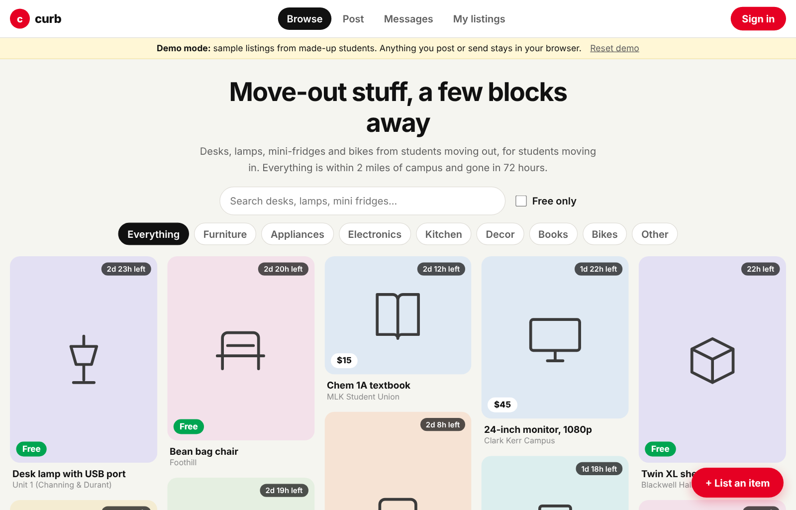

# Curb

**Perfectly good furniture shouldn't die at the dumpster.**

A peer-to-peer marketplace for students moving out and moving in: list it, match it, hand it off a few blocks away. Every listing expires after 72 hours, because move-out moves fast.

**[Try the live demo](https://tanhemdev.github.io/curb/)** (demo mode: sample listings, everything you do stays in your browser)

[](https://github.com/tanhemdev/curb/actions/workflows/ci.yml)
[](https://github.com/tanhemdev/curb/actions/workflows/pages.yml)

<p align="center"></p>

## Why I built this

During Berkeley move-out, I watched couches, desks, mini-fridges and lamps pile up on the curb: perfectly good stuff, headed straight to the landfill. Two months later at Target, I watched the next class of freshmen buy the exact same stuff brand new.

It isn't a lack of caring. It's a logistics problem: there's no easy way to hand things off when everyone is moving at the same time. Nationally, 12.1 million tons of furniture and furnishings were thrown out in 2018, about 80% of it landfilled and roughly 0.3% recycled ([EPA](https://www.epa.gov/facts-and-figures-about-materials-waste-and-recycling/durable-goods-product-specific-data)).

In an earlier move-out pilot at Berkeley, students listed **127 items**. This repository is the product rebuilt as a working app.

## How it works

1. **List it (about 30 seconds).** Snap a photo (it's shrunk in your browser before upload), pick a pickup spot, set a price or mark it free.
2. **Match.** Students browse a Pinterest-style feed filtered by category, price or search. Everything is within 2 miles of campus.
3. **Hand off.** Tap "I want this" to open a chat with the seller, meet at the pickup spot, and the seller marks it handed off.

Listings disappear after 72 hours, and sellers can relist anything that didn't go.

## What's in the code

| Feature | Where |
|---|---|
| .edu-only sign-in (magic link) | `lib/edu.js`, `components/auth/SignIn.jsx`, enforced again in the database: `supabase/migrations/0002_policies.sql` and the auth hook in `0003_edu_signup_hook.sql` |
| 72-hour expiry and relisting | `lib/expiry.js`, the `expires_at` column, and an RLS policy that hides expired rows |
| Masonry feed with filters and search | `components/feed/` |
| Listing with in-browser photo compression | `components/listing/CreateListing.jsx`, `lib/imageCompression.js` |
| Campus geofence (2 miles of UC Berkeley) | `lib/geo.js`, `lib/campus.js` |
| Buyer-seller chat, live via Supabase Realtime | `components/chat/Messages.jsx`, `lib/data/supabase.js` |
| "Mark handed off" and My listings | `components/listing/ListingDetail.jsx`, `components/me/MyListings.jsx` |
| Demo mode (the whole marketplace in localStorage) | `lib/data/demo.js`, `lib/data/seed.js` |

## Stack

| Layer | Tech | Why |
|---|---|---|
| App | Next.js 14 (App Router), React | Static export: the app is plain HTML and JS that can be hosted anywhere |
| Database | Supabase Postgres | Relational data (listings, threads, messages) with row-level security |
| Auth | Supabase Auth, email magic links | No passwords to forget during a stressful move; .edu enforced by a before-user-created hook |
| Storage | Supabase Storage | Listing photos, each user writes only to their own folder |
| Realtime | Supabase Realtime | New chat messages appear without refreshing |
| Hosting | GitHub Pages (demo), any static host (live) | |

```
browser (Next.js static app)
   │  lib/data/index.js picks a backend
   ├── demo:  lib/data/demo.js  ── localStorage (GitHub Pages demo)
   └── live:  lib/data/supabase.js ── Supabase: Postgres + RLS, Auth, Storage, Realtime
```

Security lives in the database. Row-level-security policies decide who can read and write each row, so a modified client still can't read someone else's messages or edit someone else's listing. Details: [docs/ARCHITECTURE.md](docs/ARCHITECTURE.md).

## Run it

```bash
npm install
npm run dev          # demo mode at http://localhost:3000
npm test             # unit tests
npm run build        # static export to out/
```

**Go live with Supabase:**

1. Create a Supabase project and run the three files in `supabase/migrations/` (SQL editor or `supabase db push`).
2. In Authentication → Hooks, turn on "Before User Created" with `public.hook_require_edu_email`.
3. Copy `.env.example` to `.env.local` and set `NEXT_PUBLIC_SUPABASE_URL` and `NEXT_PUBLIC_SUPABASE_ANON_KEY` (the anon key is meant to be public; RLS is what protects the data).
4. `npm run build` and host `out/` anywhere.

## Tests

`npm test` runs 11 tests on the parts that carry the product's promises: the .edu check (including look-alikes like `edu.com`), the exact 72-hour expiry, the geofence, prices, photo sizing, and the demo marketplace (feed filters, sign-in gate, expiry and relisting, handoffs, one thread per buyer, and that nobody can read someone else's thread). CI runs the tests and a full production build on every push.

## Status

- v1.0 (October 2026): working app, live demo, tested logic, database schema with security policies.
- The live Supabase backend is written but needs a project and keys to run; the public demo runs in demo mode.
- Next: push notifications when someone wants your item, and a second campus.

## Docs

[PRD](docs/PRD.md) · [User research](docs/USER_RESEARCH.md) · [Architecture](docs/ARCHITECTURE.md) · [Build log](docs/SPRINT_LOG.md) · [Metrics](docs/METRICS.md)

---

Built by [Tanya Hemdev](https://tanyahemdev.com), UC Berkeley.
